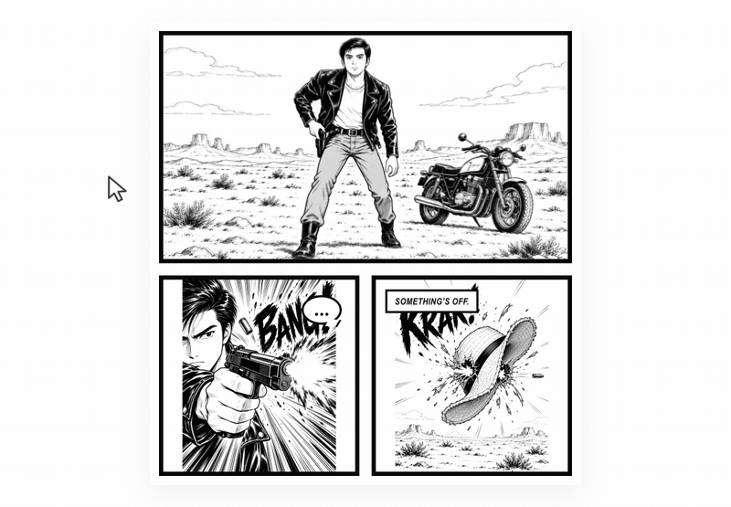

<p align="right"><strong>English</strong> · <a href="README.zh-CN.md">简体中文</a></p>

<p align="center">
  
</p>

<h1 align="center">Orbit Video Viewer</h1>

<p align="center"><strong>Turn pre-rendered orbit videos into interactive, drag-controlled views. No 3D models required.</strong></p>

<p align="center">
  <a href="#try-the-demo">Try the Demo</a> ·
  <a href="#use-it-with-an-ai-coding-agent">Use the Skill</a> ·
  <a href="#use-the-sdk">Use the SDK</a>
</p>

Orbit Comic is the included demonstration. The open-source project is the reusable interaction beneath it: load an orbit MP4, let users drag through its viewpoints, read or set the angle, and embed the result in your own product.

> **Technique credit:** This project studies an interaction technique shared by [monoradio (@monoradio102)](https://x.com/monoradio102) through a Claude Artifact. The code was independently implemented with Codex and does not copy the Artifact's source.

## What Can You Build?

<table>
  <tr>
    <td width="33%"></td>
    <td width="33%"></td>
    <td width="33%"></td>
  </tr>
  <tr>
    <td align="center"><strong>Product Viewer</strong></td>
    <td align="center"><strong>Game Item Inspection</strong></td>
    <td align="center"><strong>Interactive Comic</strong></td>
  </tr>
</table>

These are inspiration concepts, not bundled applications. The same interaction can also support exhibits, character showcases, education, architecture, and interactive art.

## Get Started

### Use it with an AI coding agent

The [`integrate-orbit-video` Skill](skills/integrate-orbit-video/SKILL.md) teaches an AI coding agent how to add this SDK and your MP4 to an existing web project while preserving that project's design.

The simplest route is to download this repository, open your own project in an AI coding tool, and give the agent three paths: your project, your MP4, and this Skill file. Then ask:

```text
Use the integrate-orbit-video Skill to add my orbit MP4 to this project.
```

For repeated use, install the whole `skills/integrate-orbit-video` folder in your tool's Skill directory. Claude Code project Skills use `.claude/skills/integrate-orbit-video/`. Codex-compatible tools can use their local or project Skill directory, or read the included `SKILL.md` directly.

The Skill follows the open `SKILL.md` Agent Skills format described by [OpenAI](https://developers.openai.com/api/docs/guides/tools-skills) and [Claude Code](https://code.claude.com/docs/en/skills). It has been designed for Codex and Claude Code, but actual file discovery and invocation depend on the AI tool and version you use. See the [Skill validation record](docs/SKILL_VALIDATION.md).

### Use the SDK

The npm package has not been published yet. For local use, build this repository and install it as a file dependency:

```bash
pnpm install
pnpm build:library
pnpm add /absolute/path/to/orbit-panel-viewer
```

```html
<div id="orbit-view" tabindex="0"></div>
```

```css
#orbit-view {
  aspect-ratio: 16 / 9;
  overflow: hidden;
  cursor: grab;
  touch-action: pan-y;
  user-select: none;
}

#orbit-view canvas { display: block; width: 100%; height: 100%; }
```

```ts
import { OrbitViewer, createMp4Source } from 'orbit-video-viewer';

const element = document.querySelector<HTMLElement>('#orbit-view');
if (!element) throw new Error('Missing orbit view.');

const viewer = new OrbitViewer({ element, initialAngle: 0 });
await viewer.load(createMp4Source('/assets/orbit.mp4'));

viewer.setAngle(90, { animate: true });
viewer.reset();
```

See the [integration guide](docs/INTEGRATION.md), [public API](#public-api), and independent [`basic-integration`](examples/basic-integration) project.

## Public API

| API | Purpose |
|---|---|
| `createMp4Source(urlOrFile)` | Load an MP4 URL, `File`, or `Blob` |
| `load(source, options?)` | Prepare and display a source |
| `getAngle()` / `getState()` | Read the current view |
| `setAngle(degrees, options?)` | Move to an exact viewpoint |
| `rotateBy(degrees, options?)` | Move relative to the current viewpoint |
| `reset(options?)` | Return to the current video's initial angle |
| `setInteractionEnabled(boolean)` | Enable or disable user input |
| `destroy()` | Release resources and listeners |

The general `OrbitSource` interface keeps the Viewer separate from decoding. This release implements browser-side MP4 processing only; it does not include a preprocessing tool.

## Source Video

For best results, use an H.264 MP4 with one continuous horizontal orbit, stable subject scale and camera height, no cuts, and an ending close to the opening view when continuous wraparound is desired.

This is controlled viewpoint playback, not real 3D. It cannot reveal missing angles, change geometry, provide collisions, or relight a scene. Audio in the MP4 is ignored.

## Try the Demo

Do not open `index.html` directly. Start the development server:

```bash
pnpm install
pnpm dev
```

Then open the local address printed by Vite. Use **Change video** to try another MP4. **Reset view** returns to the initial angle of whichever video is currently loaded.

## Project Map

```text
src/core/                   internal motion, frame, cache, and source contracts
src/library/                public OrbitViewer SDK
src/demo/                   Orbit Comic presentation
skills/integrate-orbit-video AI-assisted integration workflow
examples/basic-integration independent SDK consumer
public/demo/                bundled Orbit Comic media
```

## Documentation

- [简体中文 README](README.zh-CN.md)
- [Integration guide](docs/INTEGRATION.md)
- [Technical report](docs/TECHNICAL_REPORT.md)
- [Browser compatibility](docs/COMPATIBILITY.md)
- [Origin and attribution](docs/ORIGIN_AND_ATTRIBUTION.md)
- [Validation record](VALIDATION.md)
- [Release checklist](docs/RELEASE_CHECKLIST.md)
- [Publishing runbook (Chinese)](docs/PUBLISHING_RUNBOOK.zh-CN.md)
- [Product and publishing decisions (Chinese)](docs/PROJECT_AND_PUBLISHING.zh-CN.md)
- [Hugging Face Space README template](README.huggingface.md)

## License

The Library, Demo source, and Skill are released under the [MIT License](LICENSE). Demo and README media have separate terms in [ASSETS.md](ASSETS.md). Third-party software is listed in [THIRD_PARTY_NOTICES.md](THIRD_PARTY_NOTICES.md).
